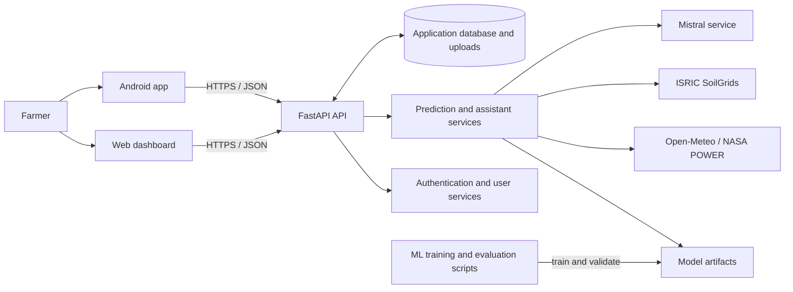
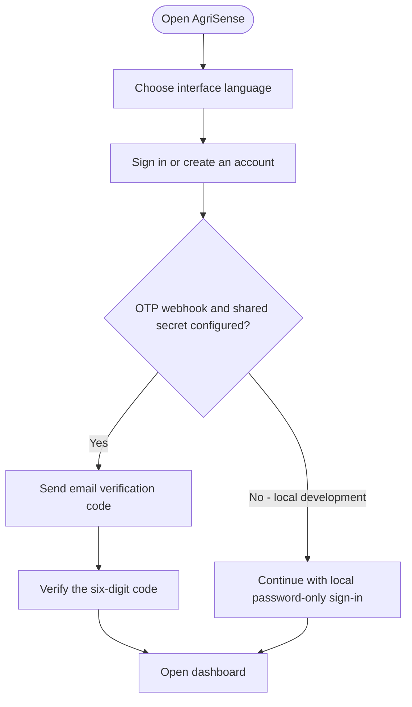
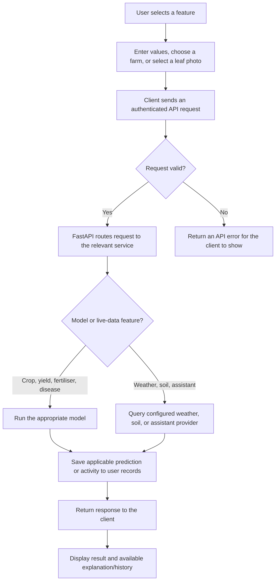

# AgriSense AI - Smart Farming Intelligence

AgriSense AI is a smart-farming platform with a FastAPI backend, a browser dashboard, machine-learning models, and a native Android client. It brings crop and fertiliser recommendations, yield estimates, leaf-disease screening, farm records, weather and soil information, and an AI assistant into one application.

**Live dashboard:** [ai.software.microeagle.online](https://ai.software.microeagle.online)

**GitHub repository:** [Vansh-Thakur-Sadyal/AgriSense-Ai](https://github.com/Vansh-Thakur-Sadyal/AgriSense-Ai)

> **Important:** Recommendations are decision-support information, not a substitute for local agronomic advice, laboratory soil testing, or professional diagnosis. Model estimates depend on their training data and input quality.

## Index

1. [Project overview](#1-project-overview)
2. [Quick search](#2-quick-search)
3. [Features and model notes](#3-features-and-model-notes)
4. [System architecture](#4-system-architecture)
5. [Application and prediction flow](#5-application-and-prediction-flow)
6. [Repository layout](#6-repository-layout)
7. [Technology stack](#7-technology-stack)
8. [Prerequisites](#8-prerequisites)
9. [Run the backend locally](#9-run-the-backend-locally)
10. [Build the Android app](#10-build-the-android-app)
11. [Run tests](#11-run-tests)
12. [Train models and build the report](#12-train-models-and-build-the-report)
13. [Configuration and secrets](#13-configuration-and-secrets)
14. [Deploy the service](#14-deploy-the-service)
15. [Git and contribution workflow](#15-git-and-contribution-workflow)
16. [Troubleshooting](#16-troubleshooting)
17. [License](#17-license)

## 1. Project overview

AgriSense has three main parts:

- **API and dashboard:** A FastAPI service exposes the application features and serves the web interface.
- **Machine-learning and data services:** Crop, yield, fertiliser, and leaf-disease models provide predictions; weather, soil, and conversational features use their configured services.
- **Android client:** A Kotlin and Jetpack Compose application consumes the same API.

The application is intended to show results from model inference, configured public data sources, and the signed-in user's records rather than fabricated demonstration predictions.

## 2. Quick search

Use this index to jump directly to common setup and development topics.

| Search for | Go to |
|---|---|
| Android, APK, Gradle, Kotlin | [Build the Android app](#10-build-the-android-app) |
| API, FastAPI, local server, Python | [Run the backend locally](#9-run-the-backend-locally) |
| Architecture, diagram, components | [System architecture](#4-system-architecture) |
| Authentication, OTP, email codes | [Configuration and secrets](#13-configuration-and-secrets) |
| Crop, fertiliser, yield, disease model | [Features and model notes](#3-features-and-model-notes) |
| Database, folders, project layout | [Repository layout](#6-repository-layout) |
| Docker, VPS, Traefik | [Deploy the service](#14-deploy-the-service) |
| Flowchart, request lifecycle | [Application and prediction flow](#5-application-and-prediction-flow) |
| Git, commits, branches, pull requests | [Git and contribution workflow](#15-git-and-contribution-workflow) |
| Model training, evaluation, report | [Train models and build the report](#12-train-models-and-build-the-report) |
| Pytest, Android tests | [Run tests](#11-run-tests) |
| Search/model quality and data sources | [Features and model notes](#3-features-and-model-notes) |

## 3. Features and model notes

| Feature | How it works | Notes |
|---|---|---|
| Crop recommendation | Compares five classifiers on `Crop_recommendation.csv`; selects the candidate using five-fold cross-validation. | Model details: [`app/models/crop_model.json`](app/models/crop_model.json). |
| Yield prediction | LightGBM estimates a correction to the three-year district mean using India Agriculture Crop Production data from 1997-2020. Evaluation uses a temporal holdout (training data before 2017-18) and compares three baselines. | Model details: [`app/models/yield_model.json`](app/models/yield_model.json). SHAP is used for per-prediction explanations. The dataset has no weather or soil fields, so those are not model inputs. |
| Fertiliser recommendation | Logistic Regression uses nitrogen, phosphorus, and potassium. Soil values are first interpreted against a crop median or Soil Health Card band. | Training data: 99 rows and seven fertiliser classes. Repeated cross-validation reported 100% on that dataset; this is not a guarantee of real-world accuracy. The app names a fertiliser and does not prescribe a dose. |
| Leaf-disease screening | Fine-tuned EfficientNet-B0 classifies a leaf image across 39 classes, including a "no leaf" class. Scores are temperature-calibrated and predictions below a validation-selected confidence threshold are refused. | The documented non-augmented evaluation set contains 55,448 images. See [`app/models/leaf_disease.json`](app/models/leaf_disease.json). |
| Weather | Open-Meteo provides current forecast data; NASA POWER provides daily historical estimates. | Historical values are gridded estimates, not readings from a farm weather station. |
| Soil | ISRIC SoilGrids 2.0 data is queried live through its WCS map service for six depths and returned with 90% ranges. | SoilGrids values are modelled estimates, not a laboratory soil test. |
| AI assistant | Mistral chat models are tried in a configured fallback order and responses can be grounded in the signed-in user's farms and predictions. | The documented assistant supports English and Hindi. Provider credentials are required. |

Soil archives in the supplied project data contain SoilGrids metadata records rather than measured soil values; the application therefore fetches soil data from the configured live service.

## 4. System architecture

The API is the integration point for both user interfaces. Model training scripts produce artifacts consumed by backend inference code; runtime requests may also use external data and AI services.



### Main code areas

- `app/main.py` defines the FastAPI application and routes.
- `app/ml.py` and `app/fertiliser.py` implement model-facing prediction logic.
- `app/external.py` integrates external weather and soil data sources.
- `app/assistant.py` handles assistant requests.
- `app/db.py` contains database access.
- `app/static/` contains the browser dashboard.
- `android/app/src/main/` contains the Android UI, API client, and session handling.
- `ml/` contains model-training scripts.

## 5. Application and prediction flow

### Sign-in and OTP flow

OTP delivery is enabled when both `OTP_WEBHOOK_URL` and `OTP_SHARED_SECRET` are configured. Without both settings, local development falls back to password-only sign-in.



Every authentication step is recorded in the `auth_events` table. Uploaded leaf photos are stored in the configured uploads location.

### Prediction and data-request flow



The exact persistence behavior depends on the selected feature. For example, prediction results are associated with the user's history; a public data lookup is not itself a model prediction.

## 6. Repository layout

```text
AgriSense-Ai/
├── app/                 # FastAPI backend, web UI, data access, and model artifacts
│   ├── models/          # Inference model files and metadata
│   ├── static/          # Browser dashboard assets
│   └── data/            # Runtime data location (may be mounted or generated)
├── android/             # Native Kotlin / Jetpack Compose Android client
├── ml/                  # Training and evaluation scripts
├── data/raw/            # Source datasets used for model development; not deployed
├── config/              # Local API configuration; secrets must not be committed
├── deploy/              # Deployment configuration, including the Traefik route
├── docs/                # Report and documentation tools
├── tests/               # Backend and UI tests
├── tools/               # Project utilities
├── Dockerfile
├── docker-compose.yml
├── requirements.txt
└── README.md
```

The SQLite database and user-generated data are runtime data. Do not treat generated database contents, uploaded images, or training datasets as source code.

## 7. Technology stack

| Layer | Technologies |
|---|---|
| Backend/API | Python 3.12, FastAPI, Uvicorn |
| Browser UI | Static HTML, CSS, and JavaScript served by the backend |
| Android | Kotlin, Jetpack Compose, Material 3, Navigation Compose |
| Android networking | OkHttp and kotlinx.serialization |
| Machine learning | scikit-learn, LightGBM, EfficientNet-B0, SHAP |
| Persistence | SQLite |
| Weather | Open-Meteo and NASA POWER |
| Soil | ISRIC SoilGrids 2.0 |
| AI assistant | Mistral API |
| Tests | pytest; Android JVM and instrumentation test source sets |
| Deployment | Docker Compose and Traefik |

## 8. Prerequisites

### Backend and model development

- Python 3.12
- Git
- Internet access for dependencies and configured live services
- CUDA-capable GPU for the full leaf-model training workflow (inference and other training scripts have their own requirements)

### Android

- Android Studio
- JDK 11 or newer
- Android SDK Platform 36
- Android emulator or device running Android 8.0 (API 26) or newer
- Network access to the configured API server

## 9. Run the backend locally

From the repository root, create a Python environment and install dependencies.

### Windows PowerShell

```powershell
py -3.12 -m venv .venv
.\.venv\Scripts\Activate.ps1
python -m pip install -r requirements.txt
python -m uvicorn app.main:app --host 127.0.0.1 --port 8150 --reload
```

The API and dashboard are then available at `http://127.0.0.1:8150`.

### macOS or Linux

```bash
python3.12 -m venv .venv
source .venv/bin/activate
python -m pip install -r requirements.txt
python -m uvicorn app.main:app --host 127.0.0.1 --port 8150 --reload
```

Some features are unavailable until their corresponding API keys and provider settings are configured.

## 10. Build the Android app

The Android project is in `android/`. Open that folder in Android Studio, let Gradle sync, choose an emulator or device, and run the `app` configuration.

From PowerShell:

```powershell
Set-Location android
.\gradlew.bat assembleDebug
```

The debug APK is written to:

```text
android/app/build/outputs/apk/debug/app-debug.apk
```

The default API base URL is defined in `android/gradle.properties` and can be overridden for a local or alternate server:

```powershell
.\gradlew.bat assembleDebug -Pagrisense.apiBase=https://your-api.example.com
```

For an emulator using a local development server, configure a host address reachable from the emulator rather than assuming `127.0.0.1` refers to the development computer. Release builds must be signed with a protected keystore before distribution.

## 11. Run tests

### Backend

From the repository root:

```powershell
python -m pytest -q
```

The test suite is under `tests/`; it covers authentication, features, models, and UI behavior.

### Android

From `android/`:

```powershell
.\gradlew.bat test
```

If a device or emulator is running, execute instrumentation tests with:

```powershell
.\gradlew.bat connectedAndroidTest
```

## 12. Train models and build the report

Training commands are run from the repository root:

```powershell
python ml/train_crop.py
python ml/train_yield.py
```

These scripts evaluate candidate models on held-out data before fitting the selected pipeline on all training rows.

The full leaf-model workflow uses CUDA and writes its final training output to `ml/staging/`:

```powershell
python ml/train_leaf_full.py --epochs 8
```

Review the individual script arguments, data requirements, and evaluation output before running a training job. Do not replace production model artifacts with staging output without reviewing validation results.

Build the model report with:

```powershell
python docs/build_report.py
```

The generated report is written to `docs/AgriSense_AI_Model_Report.pdf`.

## 13. Configuration and secrets

Keep local credentials in `config/api_keys.env` or another deployment secret store. Never commit actual API keys, passwords, OTP shared secrets, signing keys, or production user data.

Example variable names (use environment-specific values):

```dotenv
MISTRAL_API_KEY=<your-provider-key>
OTP_WEBHOOK_URL=https://<your-n8n-host>/webhook/agrisense-otp
OTP_SHARED_SECRET=<your-workflow-shared-secret>
```

For OTP sign-up, sign-in, and password reset, configure both OTP variables and ensure the n8n workflow is reachable from the backend. If the variables are absent, the documented local-development behavior is password-only sign-in.

The Android client sends bearer-token authentication for authenticated API requests. Configure the API base URL using Gradle properties; do not hard-code private credentials in the Android source.

## 14. Deploy the service

The documented VPS deployment location is `/opt/stacks/agrisense`. From that directory, build and start the service with:

```bash
docker compose up -d --build
```

Install `deploy/agrisense.yml` in the Traefik dynamic configuration directory used by the server. Keep API credentials in a read-only secret/config mount and persist application data in the deployment's Docker volume. Do not commit the VPS's live environment file or database.

## 15. Git and contribution workflow

Work on a focused branch, validate the change, and use commits that describe real milestones:

```powershell
git checkout -b docs/improve-project-guide
git status
git add README.md
git commit -m "docs: expand project README"
git push -u origin docs/improve-project-guide
```

Open a pull request against `main` for review. For a direct update to `main` when authorized by the repository's rules:

```powershell
git checkout main
git pull --ff-only origin main
git add <changed-files>
git commit -m "Describe the completed change"
git push origin main
```

Use separate commits for distinct, reviewable changes (for example, one model change and one documentation change). Avoid empty or artificial commits; a useful history records what actually changed.

Inspect history and working-tree state with:

```powershell
git status
git log --oneline --decorate -10
```

## 16. Troubleshooting

### The backend does not start

- Confirm Python 3.12 is selected and the virtual environment is active.
- Re-run `python -m pip install -r requirements.txt`.
- Check that port `8150` is available.
- Review the terminal output for missing environment variables or provider configuration.

### Android cannot reach the API

- Verify the configured API base URL and that the server is running.
- Ensure the emulator/device can reach the host computer or deployed server.
- Rebuild after changing the Gradle property.
- Check that the request uses the expected HTTP/HTTPS scheme and that the server certificate is valid.

### OTP email is not delivered

- Verify both `OTP_WEBHOOK_URL` and `OTP_SHARED_SECRET`.
- Check that the n8n workflow is active and reachable from the backend.
- Review backend logs and authentication event records without exposing secret values.

### A model or live-data feature fails

- Confirm its model artifact is present under `app/models/`.
- Check input values and feature-specific logs.
- Verify access to the configured external provider; weather, soil, and assistant features depend on their upstream services.

## 17. License

No license file is currently included in this repository. Add a suitable `LICENSE` file before granting the public broad rights to use, modify, or redistribute the project.
